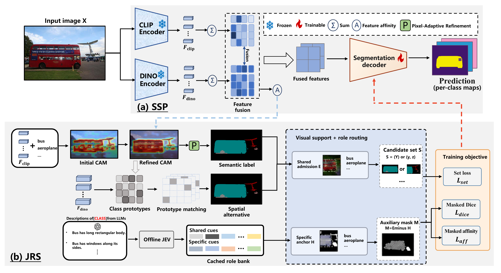

# Ground First, Commit Selectively: Role-Guided Set Supervision for Weakly Supervised Semantic Segmentation

Code for RGSS, with PASCAL VOC and MS COCO training and evaluation entrypoints.

## News

- Training and evaluation code are available.

## Overview

<p align="center">
  
</p>

RGSS matches pixel supervision to spatially supported semantic evidence. Semantic-Spatial Prediction (SSP) fuses frozen CLIP and DINOv2 features for segmentation and affinity. JEV Role-Guided Supervision (JRS) uses cached semantic roles to retain a supported class pair or preserve the semantic anchor. Candidate-set classification and coordinated auxiliary losses train the predictor. Inference uses the image without JEV queries.

## Data Preparation

### PASCAL VOC 2012

#### 1. Download

```bash
wget http://host.robots.ox.ac.uk/pascal/VOC/voc2012/VOCtrainval_11-May-2012.tar
mkdir -p data
tar -xf VOCtrainval_11-May-2012.tar -C data
```

#### 2. Segmentation Labels

Obtain the augmented annotations and additional training images from [SBD](https://home.bharathh.info/pubs/codes/SBD/download.html). Merge the training images into `JPEGImages/` to cover the complete augmented split.

```text
data/VOCdevkit/VOC2012/
├── Annotations/
├── ImageSets/Segmentation/
├── JPEGImages/
├── SegmentationClass/
├── SegmentationClassAug/
└── SegmentationObject/
```

Training uses all **10,582 train_aug images** and image-level labels. Evaluation uses all **1,449 val images**. The lists and image-level labels are included in `datasets/voc/`.

```bash
python tools/configure.py --voc-root /path/to/VOCdevkit/VOC2012
python tools/check_data.py
```

### MS COCO 2014

#### 1. Download

```bash
wget http://images.cocodataset.org/zips/train2014.zip
wget http://images.cocodataset.org/zips/val2014.zip
mkdir -p data/COCO/JPEGImages
unzip train2014.zip -d data/COCO/JPEGImages
unzip val2014.zip -d data/COCO/JPEGImages
```

#### 2. Segmentation Labels

Prepare COCO 2014 semantic masks using background `0`, foreground `1–80`, and ignore label `255`, and organize the files as shown below. Class order and COCO category IDs are in `datasets/coco/metadata.json`.

```text
data/COCO/
├── JPEGImages/
│   ├── train2014/COCO_train2014_000000000009.jpg
│   └── val2014/COCO_val2014_000000000042.jpg
└── SegmentationClass/
    └── val2014/000000000042.png
```

The complete lists and image-level labels are included in `datasets/coco/`: **82,081 training images** and **40,137 validation images**. Training reads images and image-level labels.

```bash
python tools/configure.py --config configs/coco.json --coco-root /path/to/COCO
python tools/check_data.py --config configs/coco.json
```

## Requirement

Use Python 3.11 on Linux with an NVIDIA GPU. Install dependencies and prepare the frozen encoders:

```bash
pip install torch==2.9.1 torchvision==0.24.1 --index-url https://download.pytorch.org/whl/cu128
pip install "setuptools<81" wheel "numpy==1.26.4" Cython
pip install -r requirements.txt
bash setup_pretrained.sh
```

VOC and COCO text embedding banks and the VOC JEV cache are included. Set resource paths and training options in `configs/voc.json` or `configs/coco.json`. COCO uses 81 output classes, a 320×320 crop, batch size 4, 100,000 iterations, and a learning rate of 1e-4.

For COCO JRS training, register your 80-class JEV cache (not included; [cache format](semantic_resources/README.md)):

```bash
python tools/configure.py --config configs/coco.json --role-bank /path/to/coco_role_bank.json
```

## Train RGSS

```bash
# GPU ID, output directory
bash run_train.sh 0 runs/rgss_voc
bash run_train_coco.sh 0 runs/rgss_coco
```

## Evaluate RGSS

```bash
# VOC segmentation, including multi-scale inference and DenseCRF
bash infer_seg_voc.sh 0 runs/rgss_voc results/rgss_voc

# COCO segmentation
bash infer_seg_coco.sh 0 runs/rgss_coco results/rgss_coco

# CAM seeds on the official VOC train split
bash infer_cam_voc.sh 0 runs/rgss_voc results/rgss_cam
```

The default checkpoint is `best.pt`. Each command writes to a new output directory.

## Main Results

Segmentation mIoU (%) reported in the manuscript:

| Dataset | Frozen encoders | Val | Test |
|:---|:---|---:|---:|
| PASCAL VOC 2012 | CLIP ViT-B/16 + DINOv2 ViT-B/14 | 81.2 | 81.0 |
| MS COCO 2014 | CLIP ViT-B/16 + DINOv2 ViT-B/14 | 51.9 | – |

## Citation

Please cite *Ground First, Commit Selectively: Role-Guided Set Supervision for Weakly Supervised Semantic Segmentation* when using this work.

## Acknowledgement

This implementation builds on [ExCEL](https://github.com/zwyang6/ExCEL), [CLIP](https://github.com/openai/CLIP), [DINOv2](https://github.com/facebookresearch/dinov2) and [WeCLIP](https://github.com/zbf1991/WeCLIP). Inherited source notices and upstream terms are retained in [THIRD_PARTY.md](THIRD_PARTY.md).
